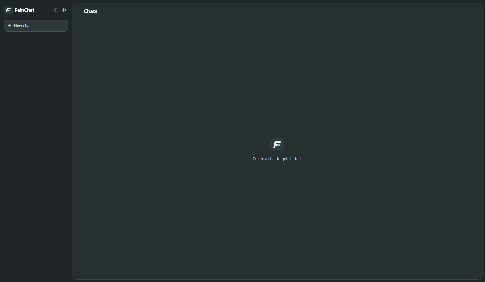
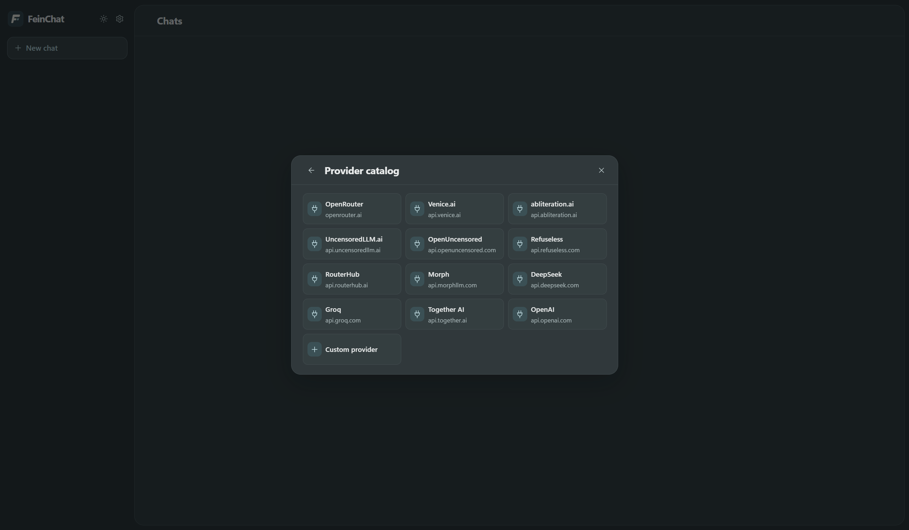
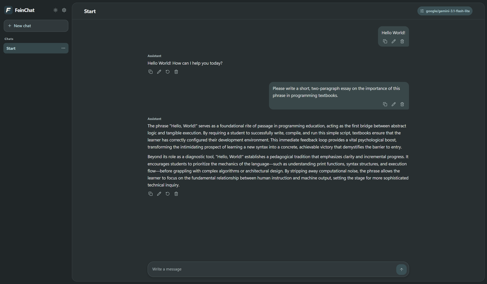
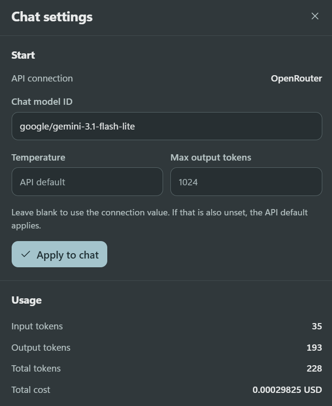

# FeinChat

FeinChat is a portable Windows app for text conversations with language models. Bring your own API key, pick a model, and chat in a single window. Use it for everyday questions, brainstorming, or writing stories. Your chat history lives in the app folder and stays available even if you switch providers or a service shuts down.

**0.1.0** · **Windows 11 x64** · **[MIT License](LICENSE)**

FeinChat supports text input and output. Images, attachments, audio, and video are outside its scope.

## Get started

1. Download `FeinChat-Windows-x64.zip` from the GitHub **Releases** page and extract the entire archive to a writable folder.
2. Run `FeinChat.exe` from that folder. The ZIP includes the runtime and needs no installer.
3. Click **New chat**. On first use, choose a provider, enter your API key and the provider’s exact text model ID, and click **Save connection**.
4. Write a message. Press **Enter** to send or **Shift+Enter** for a new line. Replies stream as they arrive. **Stop** cancels the request and keeps the text already received.

## A look inside

### The main window

The sidebar holds your chats, the **New chat** button, the light and dark theme toggle, and the **Settings** gear. The main pane is empty until you create or select a chat.



### Provider catalog

The catalog includes presets for OpenRouter, OpenAI, DeepSeek, Groq, and other providers. Presets fill in the HTTPS base URL. Select **Custom provider** to enter your own OpenAI-compatible Chat Completions endpoint. Add more connections anytime through **Settings → Add connection**. Once a default connection is configured, **New chat** uses it.



### Conversations

Use the **⋯** menu beside a chat to rename, pin, unpin, or delete it. Open **Chat settings** from that same menu or by clicking the model ID in the upper right.

You can copy, edit, and delete both your messages and the assistant’s replies. Assistant replies also have a **Regenerate** button. Saving an edit to your message requests a new reply. If an edit, deletion, or regeneration affects later messages, FeinChat asks before removing them. Markdown supports lists, quotes, tables, and code blocks with a separate copy button.



### Chat settings and usage

**Chat settings** shows the chat name, API connection, and model ID. You can set the temperature and maximum output tokens for that chat. Blank fields inherit the connection’s settings or the API defaults.

The **Usage** panel shows input, output, and total tokens, plus the cost when the provider reports it. The example below shows a cost in USD. FeinChat marks totals as partial when some requests have no reported data.



## Data and portability

FeinChat keeps its working files in `data/` beside `FeinChat.exe`. The SQLite database at `data/feinchat.sqlite3` stores your conversations, connections, API keys, settings, and usage. API keys are stored without encryption. Keep `data/` private when sharing the app.

To move FeinChat, close it and copy the entire app folder. To update, extract the new release into a separate folder, then copy your existing `data/` beside the new EXE.

Generating a reply sends the current conversation, model ID, and applicable generation settings to your configured API over HTTPS. The API key goes in the authorization header. Your provider’s retention policy still applies to those requests.

## Build from source

FeinChat uses Electron, React, Vite, and SQLite. On Windows x64, use Node.js 22.13 or newer from the 22.x series, or Node.js 24. Run these commands from the project root in PowerShell.

```powershell
npm.cmd run setup      # Install project dependencies
npm.cmd run dev        # Build the UI and launch FeinChat
npm.cmd run check      # Run tests with simulated API responses
npm.cmd run portable   # Build the unpacked Windows x64 release
```

The portable build goes to `release/build-.../win-unpacked/`. To distribute it, ZIP the entire `win-unpacked` folder.
